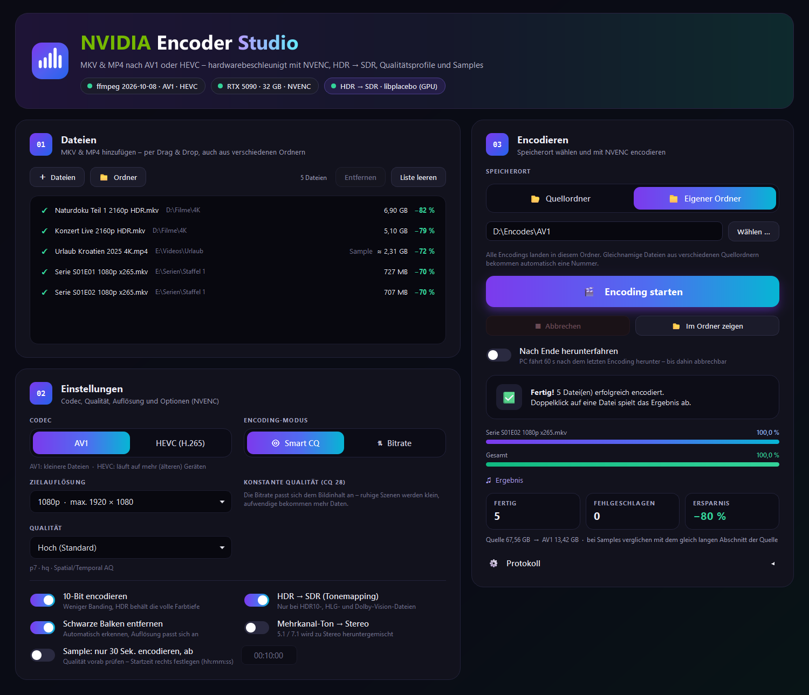

# NVIDIA Encoder Studio

Moderne Windows-Oberfläche zum Encodieren von **MKV- und MP4-Dateien nach AV1 oder HEVC (H.265)** – hardwarebeschleunigt mit **NVIDIA NVENC** über ffmpeg.



## Für wen ist die App?

Für alle, die **keine Lust haben, sich mit zig ffmpeg-Optionen und Encoder-Einstellungen auseinanderzusetzen**.

Typisches Beispiel: Vor dem Urlaub soll das **Tablet mit Filmen und Serien betankt** werden – aber der Speicher ist knapp. Dateien ins Fenster ziehen, Zielauflösung wählen, auf **„Encoding starten“** klicken, fertig. Die Standardeinstellungen liefern ohne weiteres Nachdenken gute Ergebnisse, und die Dateien werden dabei meist um ein Vielfaches kleiner. Wer mag, findet trotzdem Qualitätsprofile, HDR → SDR und mehr – muss sich damit aber nicht beschäftigen.

**Empfehlung fürs Tablet:**

- **Zielauflösung 720p** – auf einem Tablet-Display kaum von 1080p zu unterscheiden, spart aber viel Platz
- **AV1** für die kleinsten Dateien – **ältere Tablets können AV1 aber oft nicht flüssig abspielen, dann HEVC wählen**
- **Mehrkanal-Ton → Stereo** – Tablet-Lautsprecher und Kopfhörer sind ohnehin Stereo
- **HDR → SDR**, wenn das Tablet kein HDR-Display hat – sonst wirken HDR-Filme blass
- Unsicher? Erst mit dem **Sample-Modus** 30 Sekunden encodieren und auf dem Tablet ausprobieren

## Funktionen

- **AV1 oder HEVC** per NVENC (`av1_nvenc` / `hevc_nvenc`) auf der Grafikkarte
- **Drag & Drop** von Dateien und ganzen Ordnern – auch aus verschiedenen Verzeichnissen
- **Speicherort wählbar:** neben der Quelldatei oder in einem gemeinsamen Zielordner (gleichnamige Dateien werden automatisch nummeriert)
- **Smart CQ** (konstante Qualität) oder **feste Bitrate** (1–20 Mbit/s per Schieberegler)
- **Fünf Qualitätsprofile** von „Schnell“ bis „Maximum“ (Preset, Tune, Multipass, Lookahead, temporaler Filter) – unabhängig von der Bitrate
- **Zielauflösung** 540p / 720p / 1080p: das Bild wird in den Rahmen eingepasst, Seitenverhältnis bleibt, kein Hochskalieren
- **Schwarze Balken erkennen und entfernen** (Letterbox und Pillarbox) – die Auflösung passt sich automatisch an
- **HDR → SDR** (Tonemapping) für HDR10, HLG und Dolby Vision – per libplacebo auf der GPU, sonst zscale auf der CPU. Wirkt nur bei Dateien mit HDR-Metadaten
- **10-Bit-Encoding** – weniger Banding; HDR behält ohne Tonemapping seine volle Farbtiefe
- **Mehrkanal-Ton → Stereo** auf Wunsch; sonst bleibt 5.1/7.1 mit passender Bitrate erhalten
- **Sample-Modus:** nur 30 Sekunden ab einer frei wählbaren Startzeit encodieren, um die Qualität zu prüfen – mit Hochrechnung der Dateigröße für den ganzen Film
- **Live-Fortschritt** mit aktuellen FPS, Status je Datei (✓ / ✗ / ▶), fertige Größe und Ersparnis in Prozent
- **Forced-Untertitel** (Text) werden übernommen; Bild-Untertitel (PGS/VobSub) werden mit Hinweis ausgelassen
- **Auto-Shutdown** nach dem letzten Encoding – mit 60-Sekunden-Countdown zum Abbrechen
- Einstellungen werden gespeichert (außer dem Auto-Shutdown – der ist bei jedem Start aus)

## Voraussetzungen

| | |
|---|---|
| Betriebssystem | Windows 10 oder 11 |
| Grafikkarte | NVIDIA mit NVENC – **AV1** ab RTX 40 (Ada Lovelace), **HEVC** auch auf älteren Karten |
| Treiber | aktueller NVIDIA-Treiber (das Profil „Maximum“ nutzt `-tune uhq`) |
| ffmpeg | mit `av1_nvenc` und/oder `hevc_nvenc`, `ffmpeg` und `ffprobe` im `PATH` – z. B. der „full build“ von [gyan.dev](https://www.gyan.dev/ffmpeg/builds/). Für HDR → SDR auf der GPU wird `libplacebo` (Vulkan) genutzt, sonst `zscale` |
| Python | 3.10 oder neuer (getestet mit 3.14) |

## Installation

```bash
git clone https://github.com/sunnyfunny1977-alt/NVIDIA-Encoder-Studio.git
cd NVIDIA-Encoder-Studio
pip install -r requirements.txt
```

## Start

Doppelklick auf **`NVIDIA_Encoder_Studio.pyw`** (öffnet ohne Konsolenfenster) oder:

```bash
python NVIDIA_Encoder_Studio.pyw
```

Beim Start prüft das Programm ffmpeg, die Grafikkarte und den Tonemapping-Weg und zeigt das Ergebnis oben als Status-Pillen an.

## Bedienung

1. **Dateien hinzufügen** – ins Fenster ziehen oder über „＋ Dateien“ / „📁 Ordner“. Bereits erzeugte Ausgaben werden übersprungen.
2. **Einstellungen wählen** – Codec, Encoding-Modus, Zielauflösung, Qualität und Optionen.
3. **Speicherort wählen** – Quellordner oder eigener Ordner.
4. **Encoding starten.** Nach dem Lauf spielt ein Doppelklick auf eine fertige Datei das Ergebnis ab, „Im Ordner zeigen“ markiert sie im Explorer.

### Qualitätsprofile

| Profil | NVENC-Optionen |
|---|---|
| Schnell | `p4`, `hq` |
| Ausgewogen | `p6`, `hq`, Spatial/Temporal AQ |
| Hoch (Standard) | `p7`, `hq`, Spatial/Temporal AQ |
| Sehr hoch | wie Hoch + Multipass (¼ Auflösung) + Lookahead |
| Maximum | `p7`, `uhq`, Multipass (volle Auflösung), Lookahead, temporaler Filter – deutlich langsamer |

Smart CQ nutzt CQ 28 bei AV1 und CQ 24 bei HEVC (die Skalen der beiden Codecs unterscheiden sich).

### Dateinamen

Codec-Angaben (`x264`, `x265`, `hevc` …) werden entfernt, die Auflösung im Namen angepasst, bei HDR → SDR verschwinden HDR-Kennzeichnungen:

| Quelle | Ausgabe (720p) |
|---|---|
| `Film.2023.1080p.x265.mkv` | `Film.2023.720p_AV1.mp4` bzw. `…_HEVC.mp4` |
| `Film.2160p.HDR.DV.mkv` (mit HDR → SDR) | `Film.720p_AV1.mp4` |
| Sample ab 00:10:00 | `Film.2023.720p_AV1_Sample_00-10-00.mp4` |

## Tests

Die Encoder-Logik (ffprobe-Auswertung, Balkenerkennung, Auflösung, Dateinamen, ffmpeg-Argumente) ist von der Oberfläche getrennt und getestet:

```bash
pip install pytest
python -m pytest tests
```

## Projektstruktur

```
NVIDIA_Encoder_Studio.pyw   Startdatei
av1studio/
  core.py      Encoder-Logik ohne GUI: ffprobe, HDR, Balken, Auflösung, ffmpeg-Argumente
  worker.py    Encoding im Hintergrund-Thread (Fortschritt, FPS, Abbruch)
  app.py       Hauptfenster
  widgets.py   eigene Bedienelemente (Schalter, Segment-Umschalter, Dateiliste …)
  style.py     Farben und Qt-Stylesheet
tests/
  test_core.py
docs/
  screenshot.png
```

## Lizenz

[MIT](LICENSE)

---

*Kein offizielles NVIDIA-Produkt. NVIDIA, NVENC und GeForce sind Marken der NVIDIA Corporation.*
